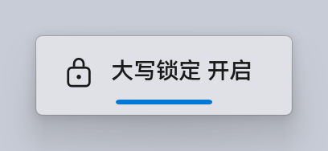
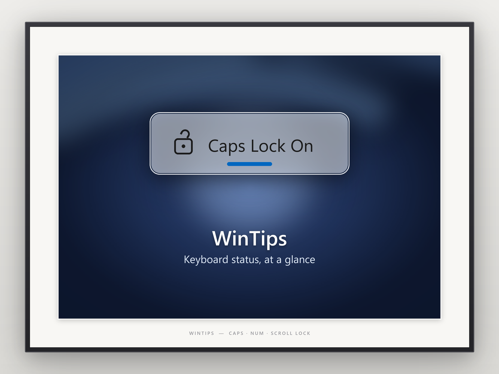

<div align="center">


# WinTips

A keyboard state indicator for Windows

[](https://github.com/DoYouNatureQ/WinTips/releases)
[](LICENSE)
[](#system-requirements)
[](https://dotnet.microsoft.com/download)

[简体中文](README.md) | English

</div>

WinTips is a tray-resident Windows utility. When you press Caps Lock, Num Lock, Scroll Lock or Insert, or copy, paste or cut, it slides a flyout with an acrylic finish in from the screen edge and reports the key state or the action performed; the flyout fades out after 0.5–5 seconds. The app has no main window, makes no network requests, and has no third-party dependencies.

## Contents

- [Features](#features)
- [Screenshots](#screenshots)
- [System requirements](#system-requirements)
- [Installation](#installation)
- [Usage](#usage)
- [Configuration](#configuration)
- [Building](#building)
- [Project layout](#project-layout)
- [Implementation notes](#implementation-notes)
- [Known limitations](#known-limitations)
- [Contributing](#contributing)
- [License](#license)
- [Credits](#credits)

## Features

| Area | Description |
| --- | --- |
| Lock keys | Reports the on/off state of Caps Lock, Num Lock and Scroll Lock, with a padlock icon and an accent bar |
| Insert | Reports a single Insert press as an event; no on/off state is implied |
| Clipboard | Shows an icon for Ctrl+C, Ctrl+V and Ctrl+X, with an `×N` badge counting consecutive actions |
| Input method (off by default) | Reports the input language or the Chinese/English mode after a switch |
| Appearance | Follows the system theme, accent color and DPI; flyout size, opacity, animation speed and display duration are configurable |
| Placement | Snaps on two axes — vertical and horizontal — and slides in from the edge it sits against; can also be dragged anywhere |
| Multiple displays | Follows the focused display by default and uses that display's DPI and taskbar state |
| UI language | 简体中文, 繁體中文, English, Deutsch, 日本語, Русский, Español, Português; follows the system by default |
| Font | HarmonyOS Sans SC is embedded (three weights compiled into the assembly); any installed font can be used instead |
| Runtime behaviour | Tray-resident, single instance, click-through, never steals focus, absent from the taskbar and Alt+Tab |

## Screenshots

| Light theme | Dark theme |
| :---: | :---: |
|  |  |



## System requirements

| Item | Requirement |
| --- | --- |
| Operating system | Windows 10 1809 (10.0.17763) or later; fully supported on Windows 11 |
| Installer / Store build | Windows 10 2004 (10.0.19041) or later, as required by the MSIX manifest |
| Architecture | x64 |
| Runtime | None. Release builds are self-contained single files with the .NET 10 runtime bundled |
| Privileges | Standard user; administrator rights are not required |

## Installation

### Microsoft Store

Install from the [Microsoft Store](https://apps.microsoft.com/detail/9nj5xdw5pd79); updates are delivered by the Store.

### Installer

Download `WinTipsSetup-<version>.exe` from [Releases](https://github.com/DoYouNatureQ/WinTips/releases/latest) and run the wizard. It installs per user (default directory `%LOCALAPPDATA%\Programs\WinTips`) without a UAC prompt; enable launch at startup from the Settings window afterwards, and uninstall from Settings → Apps.

### Portable

The release artifact is a single `WinTips.exe`. Run it from any directory; nothing is written outside `%APPDATA%\WinTips` (see [Configuration](#configuration)).

### Windhawk mod

WinTips is also available as the Windhawk mod [WinTips OSD](https://windhawk.net/mods/wintips-osd), which runs as a tool mod in its own `windhawk.exe` process — nothing is injected into other programs and no system functions are hooked. The mod shares the same interface design and is independent of the standalone build, but the two **should not both launch at startup**: while the standalone app is running, the mod suppresses itself. See [Windhawk/README.md](Windhawk/README.md) for details.

## Usage

The app shows only a tray icon; there is no main window.

| Action | Result |
| --- | --- |
| First launch | Shows a one-time "is running" flyout that confirms the app is running in the background and points at the tray icon; it does not appear again |
| Left-click the tray icon | Opens Settings |
| Right-click the tray icon | Opens the menu: Settings, Test tips, Exit |

### Command line

| Argument | Description |
| --- | --- |
| `--settings` | Opens Settings after startup |
| `--test <key> [on\|off] [seconds]` | Previews a tip. `<key>` is one of `caps`, `num`, `scroll`, `insert`, `copy`, `paste`, `cut`, `lang` |
| `--test menu` | Previews the tray menu at the cursor position |

```bat
WinTips.exe --settings
WinTips.exe --test caps on 4
WinTips.exe --test lang
```

## Configuration

All options are set in the Settings window and take effect immediately; no restart is required.

| Option | Values / range |
| --- | --- |
| Tip content | Caps Lock, Num Lock, Scroll Lock, Insert, Copy, Paste, Cut, any copy method, input language and Chinese/English mode |
| Display duration | 0.5–5 seconds |
| Animation speed | 0–3× |
| Flyout size | 0.6–2.0× |
| Blur effect | On/off, with opacity from 0.20 to 0.90 |
| Placement | Snapping on the vertical and horizontal axes, or a custom dragged position |
| Follow the focused display | On/off |
| Launch at startup | On/off |
| UI language | Follow the system, or one of eight languages |
| UI font | The embedded HarmonyOS Sans SC, or any installed font |

### File locations

| Path | Contents |
| --- | --- |
| `%APPDATA%\WinTips\settings.json` | All settings. Carries a schema version; older formats are migrated automatically on upgrade |
| `%APPDATA%\WinTips\error.log` | Unhandled exception log, written only when an exception occurs |

### settings.json fields

| Field | Type | Default | Description |
| --- | --- | --- | --- |
| `ShowCapsLock` / `ShowNumLock` / `ShowScrollLock` | bool | `true` | Whether each lock key is reported |
| `ShowInsert` | bool | `true` | Whether Insert is reported |
| `ShowCopy` / `ShowPaste` / `ShowCut` | bool | `true` | Whether each clipboard action is reported |
| `ShowAnyCopy` | bool | `true` | Also report non-keyboard copies such as context menus and in-app Copy buttons |
| `ShowLanguageTip` | bool | `false` | Whether the input language and Chinese/English mode are reported |
| `DisplaySeconds` | double | `2.0` | How long the flyout stays on screen, in seconds |
| `AnimationSpeed` | double | `1.0` | Animation duration multiplier; `0` disables animation |
| `TipScale` | double | `1.0` | Flyout size multiplier, clamped to 0.6–2.0 |
| `TipGlass` | bool | `true` | Whether to blur the content behind the flyout in real time |
| `TipGlassOpacity` | double | `0.55` | Opacity of the blurred layer, clamped to 0.20–0.90 |
| `TipPlacement` | string | `"Center"` | Horizontal placement: `Left`, `Center`, `Right` |
| `TipVertical` | string | `"Bottom"` | Vertical placement: `Top`, `Bottom` |
| `TipFollowFocus` | bool | `true` | Whether to follow the focused display |
| `CustomLeft` / `CustomTop` | double? | `null` | Custom position relative to the display's top-left corner; both must be set to take effect |
| `LaunchAtStartup` | bool | `false` | Launch at startup |
| `Language` | string | `"System"` | UI language |
| `UiFont` | string | `""` | UI font; an empty string selects the embedded font |
| `SettingsVersion` | int | `5` | Settings schema version, maintained by the app |

### Environment variables

For debugging only; not needed for normal use.

| Variable | Effect |
| --- | --- |
| `WINTIPS_GPU=1` | Enables GPU rendering. Software rendering is the default |
| `WINTIPS_NO_HOOK=1` | Skips installing the low-level keyboard hook, to exercise the Raw Input fallback path |

## Building

### Prerequisites

| Tool | Version | Purpose |
| --- | --- | --- |
| [.NET SDK](https://dotnet.microsoft.com/download) | 10.0 | Required to compile |
| Windows SDK | including `makeappx.exe` | Optional; required to build the MSIX package |
| [Inno Setup](https://jrsoftware.org/isinfo.php) | 6.4 or later | Optional; required to build the installer |

If the latter two are missing, the one-click build script skips the corresponding packaging step and still produces a working executable.

### From source

```bat
git clone https://github.com/DoYouNatureQ/WinTips.git
cd WinTips

:: Debug build
dotnet build

:: Publish: single file, self-contained, x64
dotnet publish -c Release -r win-x64 --self-contained true -p:PublishSingleFile=true -p:IncludeNativeLibrariesForSelfExtract=true -p:EnableCompressionInSingleFile=false -o publish
```

### One-click build

```bat
:: Stop the running instance, clean, publish, package and restart
Build\rebuild.bat

:: Same, but skip the MSIX and installer steps
Build\rebuild.bat /nopack
```

The script runs `stop → clean bin/obj/publish → publish → package → start` and aborts on the first required step that fails. The version number is maintained only in `<Version>` in `WinTips.csproj`; the packaging scripts read it from the build output and keep no copy of their own.

### Build artifacts

| Artifact | Description |
| --- | --- |
| `publish\WinTips.exe` | Self-contained single-file executable |
| `Build\dist\WinTips_<version>_x64.msix` | Microsoft Store submission package. Requires `Build\msix\identity.json` with the identity registered in Partner Center |
| `Build\dist\WinTips_<version>_x64_local.msix` | Packaged with a placeholder identity; validates the packaging pipeline only and cannot be uploaded |
| `Build\dist\WinTipsSetup-<version>.exe` | Inno Setup installer |

## Project layout

| Path | Contents |
| --- | --- |
| `App/` | Application entry point: single instance, startup sequence and wiring of the key capture paths |
| `Core/` | Non-UI logic: settings, localization, lock-key state machine, tip controller, startup registration, fonts |
| `UI/` | WPF windows and controls: flyout, settings, tray menu, placement picker, license |
| `Native/` | Win32 interop: DWM acrylic, desktop capture, taskbar information, Raw Input |
| `Resources/` | Icons, style sheet, embedded fonts and the font license |
| `Build/` | Build and packaging: `rebuild.bat`, MSIX script, Inno Setup script |
| `Windhawk/` | Windhawk mod variant: mod source, standalone test harness, mod page assets |
| `promo/` | Promotional images and demo videos used by the Store and documentation |

## Implementation notes

- **Three key capture paths.** Under normal conditions keys are captured by a low-level keyboard hook (`WH_KEYBOARD_LL`). When the foreground window runs elevated, UIPI truncates callbacks destined for higher-integrity windows, so Raw Input reads the keys from the device stack instead. If neither is available (Remote Desktop, on-screen keyboards), key-state polling takes over. All three feed `LockState`, which de-duplicates by the time the key was pressed rather than the time it was handled, so a single press is never toggled twice.
- **No `GetKeyState` for state.** That mirror is not updated for threads without focus, so state is maintained by toggling on each press; the baseline is read once at startup.
- **Glass and background.** Windows 11 uses DWM acrylic and system corners; Windows 10 captures the desktop and blurs it, drawing its own rounded corners; high contrast mode or system transparency disabled falls back to a solid colour. With blur enabled, the flyout excludes itself from capture via `WDA_EXCLUDEFROMCAPTURE` and keeps re-capturing the desktop while visible, so the glass tracks what is behind it.
- **Footprint.** The tray icon uses native `Shell_NotifyIcon` and WinForms is disabled in the project, removing roughly 19.8 MB of resident assemblies. Single-file compression is turned off: compression unpacks managed assemblies into private committed memory, measured at 83.5 MB private working set versus 38.8 MB uncompressed. MSIX and the installer are compressed containers, so the download size is barely affected.

## Known limitations

| Limitation | Explanation |
| --- | --- |
| Insert has no on/off state | Windows does not track that state at the system level, so the tip reports the press only. Only a bare Insert counts; with Ctrl or Shift held it is a copy or a paste |
| Keys in elevated windows | While an elevated window has focus, keys are captured by Raw Input and polling. They are still reported, with up to about 50 ms of extra latency. The IME's Chinese/English mode cannot be read in that state, so only the language is shown |
| IME mode | Depends on the IME reporting its conversion mode. Most IMEs do; a few third-party IMEs do not, and their mode switches produce no tip |
| Mouse-driven IME switching | Switching from the language bar or the IME status bar produces no tip: there is no keystroke to attach to and no system notification |
| Exclusive fullscreen | In true exclusive fullscreen (not borderless) the game owns the display pipeline and no other window can be drawn over it. Borderless fullscreen and windowed mode are unaffected |
| Non-keyboard cut | The "Cut" context-menu item cannot be distinguished from a copy and is shown with the copy style |
| Screenshots and recordings | With blur enabled, the flyout is excluded from screen capture for the 1–2 seconds it is visible; otherwise each re-capture would photograph the flyout itself. Remote Desktop sessions and older Windows 10 builds cannot refresh in real time and fall back to a single capture taken before the flyout appears, in which case it does show up in screenshots |
| Multi-display following | Tips land on the display of the active window by default. Disable "Follow the focused display" to keep them on the primary display |

## Contributing

- **Bug reports**: open an [issue](https://github.com/DoYouNatureQ/WinTips/issues) describing your Windows version, the steps to reproduce and the expected behaviour, and attach `%APPDATA%\WinTips\error.log` if it exists.
- **Pull requests**: state the motivation and the scope of the change, and match the existing code style. The project does not take on third-party runtime dependencies.

## License

WinTips is released under the **GNU General Public License v3.0**. See [LICENSE](LICENSE) for the full text.

## Credits

- The flyout's look and motion are based on the LockWindow design in [FluentFlyout](https://github.com/unchihugo/FluentFlyout), also released under GPL-3.0. This is an independent implementation, and the licenses are compatible.
- The UI font **HarmonyOS Sans SC** is © Huawei Device Co., Ltd. and is redistributed unmodified with the app under the [HarmonyOS Sans Fonts License Agreement](Resources/Fonts/LICENSE_Fonts.txt). The font files are not modified, hence no subsetting, and are never distributed on their own. The full agreement is kept in the repository and compiled into the assembly: click the version number at the bottom of the Settings window and choose "Show full agreement" to read it.

---

[↑ Back to top](#wintips) · [中文版](README.md)
