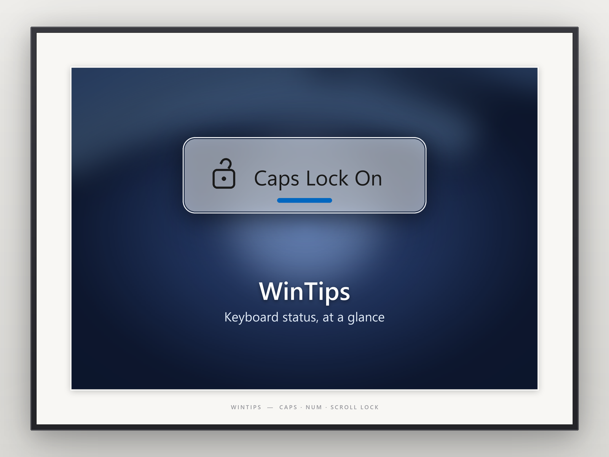

<div align="center">

# WinTips

[](LICENSE)   

[简体中文](README.md) | **English**



</div>

A Windows 11-style keyboard state indicator: press **Caps Lock / Num Lock / Scroll Lock** (or copy / paste / cut) and an acrylic flyout with Win11 polish appears just above the taskbar.

## Features

- **Lock-key hints**: Caps / Num / Scroll Lock and Insert — a padlock icon spins and springs back on each toggle, with an accent bar at the bottom and a fade plus slide toward the nearest screen edge.
- **Edge-aware slide**: inside the 15% zone along any screen edge the flyout slides in from (and back toward) that edge — Left/Right outrank Top/Bottom, so corners slide horizontally too — and falls back to a vertical slide when it sits mid-screen.
- **Clipboard hints**: Ctrl+C / V / X shows a checkmark or scissors icon, with an "×N" badge counting consecutive actions; the flyout only appears when the clipboard actually changes. "Notify on any copy method" is on by default — non-keyboard copies (context menu, an app's own Copy button, etc.) trigger it too, while clearing the clipboard does not.
- **Native materials**: DWM acrylic, system rounded corners, light/dark theme and accent color follow the system, high-DPI aware.
- **Unobtrusive**: click-through, never steals focus, hidden from the taskbar and Alt+Tab, auto-dismisses after 1–5 seconds (adjustable).
- **Settings window**: Win11 Settings styling, applied and saved instantly. Flyout position is two independent axes — Top/Bottom plus Left/Center/Right (Top + Center, Top + Right, Bottom + Center, …) — or choose "Custom position" and drag the flyout anywhere, then save (one click restores the default).
- **Visual placement**: in custom-position mode dashed guides mark the 15% edge zones and the zone the flyout center falls into is highlighted (that is the side it will slide from); the flyout snaps to the screen's center axes, and the arrow keys nudge it pixel by pixel (tap = 1 px, hold to repeat, Shift = 10 px).
- **Bilingual UI**: built-in Simplified Chinese and English. Follows the system language by default; switch anytime under "Interface language" in Settings — effective immediately, no restart.
- Lives in the tray, single instance, no third-party dependencies (WPF + WinForms, .NET 10).

## Usage

Just run `WinTips.exe` — once the tray icon appears, it is working.

- Tray left-click → Settings; right-click → menu (including test notifications).
- Command line: `--settings` opens Settings; `--test caps on 4` previews a notification; `--test menu` previews the menu.
- Settings are stored in `%APPDATA%\WinTips\settings.json`.

## Build and Publish

Requires the .NET 10 SDK (Windows).

```powershell
# Debug build
dotnet build -c Release

# Publish a single-file exe (no .NET runtime required, ~70 MB)
dotnet publish -c Release -r win-x64 --self-contained true `
  -p:PublishSingleFile=true -p:IncludeNativeLibrariesForSelfExtract=true `
  -p:EnableCompressionInSingleFile=true -o publish
```

> One-click rebuild: double-click `rebuild.bat` in the repo root (kills the old process → cleans bin/obj/publish and the single-file extraction cache → republishes → relaunches).

### One-click rebuild

Double-click `rebuild.bat` in the repo root. It will:

1. Verify that `dotnet` and a `.csproj` are present (abort with an error if not);
2. Kill any running `WinTips.exe` and wait until the process has fully exited (so no file locks remain);
3. Delete `bin` / `obj` / `publish` (and tell you if a directory is still in use);
4. Clean the single-file extraction cache under `%TEMP%\.net\WinTips\` (every publish changes the hash, so old folders are never reused — they pile up at roughly 8 MB each);
5. Republish to `publish\` as a single-file, self-contained, compressed build;
6. Confirm the output exists, then launch the new exe.

Any failing step `pause`s and leaves the state intact for inspection.

## Known Limitations

- The Insert hint is event-based and shows no on/off state (Windows does not track that state at the system level).
- Notifications appear on the primary display only.
- A low-level keyboard hook cannot see keys sent to elevated (administrator) windows.
- Cuts from non-keyboard sources (e.g. the "Cut" context-menu item) cannot be told apart from copies and are shown with the copy style.

## Credits

The flyout's look and motion are recreated from the LockWindow design in [FluentFlyout](https://github.com/unchihugo/FluentFlyout) (GPL-3.0); the code here is an independent implementation.

---

[↑ Back to top](#wintips) · [中文版](README.md)
