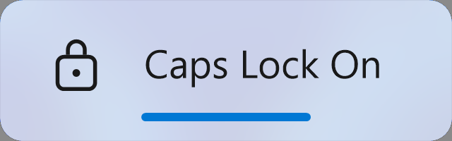
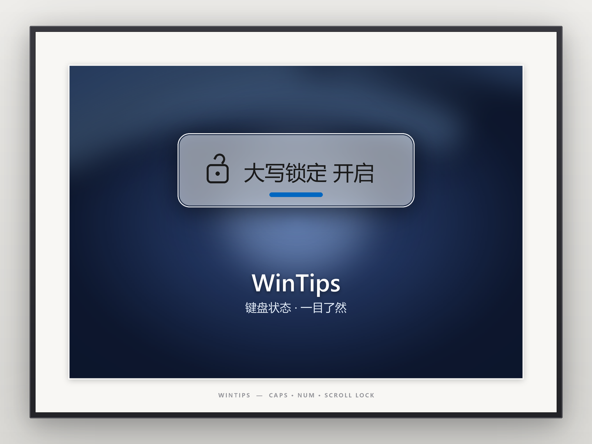

<div align="center">


# WinTips

Windows 键盘状态提示工具

[](https://github.com/DoYouNatureQ/WinTips/releases)
[](LICENSE)
[](#系统要求)
[](https://dotnet.microsoft.com/download)

简体中文 | [English](README.en.md)

</div>

WinTips 是一个常驻系统托盘的 Windows 桌面程序。按下 Caps Lock、Num Lock、Scroll Lock、Insert，或执行复制、粘贴、剪切时，程序在屏幕边缘滑出一个亚克力质感的浮窗，显示当前按键状态或操作；浮窗在 0.5–5 秒后自动淡出。程序无主窗口、不联网、不依赖第三方组件。

## 目录

- [功能](#功能)
- [界面](#界面)
- [系统要求](#系统要求)
- [安装](#安装)
- [使用](#使用)
- [配置](#配置)
- [构建](#构建)
- [项目结构](#项目结构)
- [实现说明](#实现说明)
- [已知限制](#已知限制)
- [参与贡献](#参与贡献)
- [许可](#许可)
- [致谢](#致谢)

## 功能

| 类别 | 说明 |
| --- | --- |
| 锁定键 | Caps Lock、Num Lock、Scroll Lock 切换时显示开关状态，附挂锁图标与强调色指示条 |
| Insert | 单独按下 Insert 时显示事件提示，不表示开关状态 |
| 剪贴板 | Ctrl+C / Ctrl+V / Ctrl+X 显示对应图标；连续操作以 `×N` 计数 |
| 输入法（默认关闭） | 切换输入语言或输入法内部中英文模式后，显示切换结果 |
| 外观 | 跟随系统深浅色、强调色与 DPI；浮窗尺寸、不透明度、动画速度、显示时长均可调 |
| 定位 | 垂直、水平两轴吸附，滑入方向随所贴边缘变化，也可拖拽至任意位置 |
| 多显示器 | 默认跟随焦点所在显示器，按该屏的 DPI 与任务栏状态定位 |
| 界面语言 | 简体中文、繁體中文、English、Deutsch、日本語、Русский、Español、Português，默认跟随系统 |
| 字体 | 内置 HarmonyOS Sans SC（三个字重编译进程序集），也可改用系统已安装的任意字体 |
| 运行形态 | 托盘常驻、单实例、点击穿透、不抢焦点、不出现在任务栏与 Alt+Tab 中 |

## 界面

| 浅色主题 | 深色主题 |
| :---: | :---: |
|  |  |



## 系统要求

| 项目 | 要求 |
| --- | --- |
| 操作系统 | Windows 10 1809（10.0.17763）及以上；Windows 11 完整支持 |
| 安装包 / 商店版 | Windows 10 2004（10.0.19041）及以上，受 MSIX 清单限制 |
| 处理器架构 | x64 |
| 运行时 | 无需单独安装。发布版本为自包含单文件，已内置 .NET 10 运行时 |
| 权限 | 普通用户权限，无需管理员 |

## 安装

### Microsoft Store

从 [Microsoft Store](https://apps.microsoft.com/detail/9nj5xdw5pd79) 安装，由商店负责更新。

### 安装包

从 [Releases](https://github.com/DoYouNatureQ/WinTips/releases/latest) 下载 `WinTipsSetup-<版本>.exe` 并按向导安装。安装为当前用户级（默认目录 `%LOCALAPPDATA%\Programs\WinTips`），不触发 UAC；安装完成后可在设置中开启开机启动，卸载入口在「设置 → 应用」中。

### 便携版

发布产物为单个 `WinTips.exe`，放置于任意目录直接运行即可，不写入系统目录。设置与日志仍保存在 `%APPDATA%\WinTips`（见[配置](#配置)）。

### Windhawk 模组

WinTips 另提供 Windhawk 模组版本 [WinTips OSD](https://windhawk.net/mods/wintips-osd)，作为 tool mod 运行在 `windhawk.exe` 独立进程中，不注入其他程序，也不 hook 系统函数。模组与独立版共用同一套界面设计，互不影响，但**不应同时设置开机启动**：独立版运行时模组会自动静默。模组说明见 [Windhawk/README.md](Windhawk/README.md)。

## 使用

程序启动后仅显示托盘图标，没有主窗口。

| 操作 | 结果 |
| --- | --- |
| 首次启动 | 弹出一次「已启用」提示，说明程序已在后台运行并指出托盘图标位置，此后不再出现 |
| 左键单击托盘图标 | 打开设置窗口 |
| 右键单击托盘图标 | 打开菜单：设置、测试提示、退出 |

### 命令行

| 参数 | 说明 |
| --- | --- |
| `--settings` | 启动后直接打开设置窗口 |
| `--test <键位> [on\|off] [秒数]` | 预览提示。键位取 `caps`、`num`、`scroll`、`insert`、`copy`、`paste`、`cut`、`lang` |
| `--test menu` | 在光标位置预览托盘菜单 |

```bat
WinTips.exe --settings
WinTips.exe --test caps on 4
WinTips.exe --test lang
```

## 配置

所有设置均在设置窗口中调整，修改即时生效并保存，无需重启程序。

| 设置项 | 可选值 / 范围 |
| --- | --- |
| 提示内容 | Caps Lock、Num Lock、Scroll Lock、Insert、复制、粘贴、剪切、任意复制方式、输入法语言与中英文 |
| 显示时长 | 0.5–5 秒 |
| 动画速度 | 0–3 倍 |
| 提示大小 | 0.6–2.0 倍 |
| 模糊效果 | 开 / 关，及 0.20–0.90 的不透明度 |
| 提示位置 | 垂直、水平两轴吸附，或拖拽至自定义位置 |
| 跟随焦点显示器 | 开 / 关 |
| 开机启动 | 开 / 关 |
| 界面语言 | 跟随系统，或八种语言中任选 |
| 界面字体 | 内置 HarmonyOS Sans SC，或系统已安装的字体 |

### 文件位置

| 路径 | 内容 |
| --- | --- |
| `%APPDATA%\WinTips\settings.json` | 全部设置。带有配置版本号，升级后自动迁移旧格式 |
| `%APPDATA%\WinTips\error.log` | 未处理异常日志，仅在出现异常时写入 |

### settings.json 字段

| 字段 | 类型 | 默认值 | 说明 |
| --- | --- | --- | --- |
| `ShowCapsLock` / `ShowNumLock` / `ShowScrollLock` | bool | `true` | 各锁定键是否提示 |
| `ShowInsert` | bool | `true` | Insert 是否提示 |
| `ShowCopy` / `ShowPaste` / `ShowCut` | bool | `true` | 剪贴板操作是否提示 |
| `ShowAnyCopy` | bool | `true` | 右键菜单、应用内「复制」按钮等非键盘复制是否也提示 |
| `ShowLanguageTip` | bool | `false` | 输入法语言与中英文模式是否提示 |
| `DisplaySeconds` | double | `2.0` | 浮窗停留时长（秒） |
| `AnimationSpeed` | double | `1.0` | 动画时长倍率，`0` 关闭动画 |
| `TipScale` | double | `1.0` | 浮窗大小倍率，限制在 0.6–2.0 |
| `TipGlass` | bool | `true` | 是否实时模糊浮窗背后的画面 |
| `TipGlassOpacity` | double | `0.55` | 模糊层不透明度，限制在 0.20–0.90 |
| `TipPlacement` | string | `"Center"` | 水平位置：`Left`、`Center`、`Right` |
| `TipVertical` | string | `"Bottom"` | 垂直位置：`Top`、`Bottom` |
| `TipFollowFocus` | bool | `true` | 是否跟随焦点显示器 |
| `CustomLeft` / `CustomTop` | double? | `null` | 自定义位置（相对所在显示器左上角），两者同时有值才生效 |
| `LaunchAtStartup` | bool | `false` | 开机启动 |
| `Language` | string | `"System"` | 界面语言 |
| `UiFont` | string | `""` | 界面字体，空字符串表示内置字体 |
| `SettingsVersion` | int | `5` | 配置格式版本，由程序维护 |

### 环境变量

以下变量仅供调试，正常使用无需设置。

| 变量 | 作用 |
| --- | --- |
| `WINTIPS_GPU=1` | 启用 GPU 渲染。默认使用软件渲染 |
| `WINTIPS_NO_HOOK=1` | 不安装低级键盘钩子，用于验证 Raw Input 兜底路径 |

## 构建

### 前置条件

| 工具 | 版本 | 用途 |
| --- | --- | --- |
| [.NET SDK](https://dotnet.microsoft.com/download) | 10.0 | 编译必需 |
| Windows SDK | 含 `makeappx.exe` | 可选，构建 MSIX 包时需要 |
| [Inno Setup](https://jrsoftware.org/isinfo.php) | 6.4 及以上 | 可选，构建安装包时需要 |

缺少后两者时，一键构建脚本会跳过对应的打包步骤，不影响可执行程序的构建。

### 从源码构建

```bat
git clone https://github.com/DoYouNatureQ/WinTips.git
cd WinTips

:: 调试构建
dotnet build

:: 发布：单文件、自包含、x64
dotnet publish -c Release -r win-x64 --self-contained true -p:PublishSingleFile=true -p:IncludeNativeLibrariesForSelfExtract=true -p:EnableCompressionInSingleFile=false -o publish
```

### 一键构建

```bat
:: 停止运行中的实例、清理、发布、打包、重新启动
Build\rebuild.bat

:: 同上，但跳过 MSIX 与安装包
Build\rebuild.bat /nopack
```

脚本按 `停止进程 → 清理 bin/obj/publish → 发布 → 打包 → 启动` 的顺序执行，任一必需步骤失败即中止。版本号只维护 `WinTips.csproj` 中的 `<Version>`，打包脚本从产物读取，不另行保存。

### 构建产物

| 产物 | 说明 |
| --- | --- |
| `publish\WinTips.exe` | 单文件自包含可执行程序 |
| `Build\dist\WinTips_<版本>_x64.msix` | Microsoft Store 提交包。需 `Build\msix\identity.json` 提供与 Partner Center 一致的标识 |
| `Build\dist\WinTips_<版本>_x64_local.msix` | 使用占位标识打包，仅供本地验证打包链路，不可上传 |
| `Build\dist\WinTipsSetup-<版本>.exe` | Inno Setup 安装包 |

## 项目结构

| 路径 | 内容 |
| --- | --- |
| `App/` | 应用入口：单实例、启动流程与按键捕获路径的装配 |
| `Core/` | 无 UI 逻辑：设置、本地化、锁定键状态机、提示控制器、启动项、字体 |
| `UI/` | WPF 窗口与控件：提示浮窗、设置、托盘菜单、位置选择、许可 |
| `Native/` | Win32 互操作：DWM 亚克力、桌面快照、任务栏信息、Raw Input |
| `Resources/` | 图标、样式表、内嵌字体与字体许可协议 |
| `Build/` | 构建与打包：`rebuild.bat`、MSIX 脚本、Inno Setup 脚本 |
| `Windhawk/` | Windhawk 模组版本：模组源码、独立调试台、模组页素材 |
| `promo/` | 商店与文档使用的宣传图、演示视频 |

## 实现说明

- **三路按键捕获。** 常规情况下由低级键盘钩子（`WH_KEYBOARD_LL`）捕获；当前台窗口以管理员权限运行时，UIPI 会截断发往高完整性级别窗口的按键回调，此时改由 Raw Input 从设备栈读取；两者均不可用（远程桌面、虚拟键盘）时，由按键状态轮询兜底。三路事件统一交给 `LockState` 去重，以按键发生时刻而非处理时刻判定，避免同一次按键被翻转两次。
- **不依赖 `GetKeyState` 取状态。** 该镜像对没有焦点的线程不更新，故状态由「按下即翻转」维护，仅在启动时读取一次基线。
- **玻璃与背景。** Windows 11 使用 DWM 亚克力与系统圆角；Windows 10 改为抓取桌面快照自行模糊并绘制圆角；高对比度模式或系统关闭透明效果时退回不透明纯色。开启模糊时，浮窗以 `WDA_EXCLUDEFROMCAPTURE` 将自身排除出抓屏，并在可见期间持续重抓背景，使玻璃内的画面与背后内容同步。
- **资源占用。** 托盘图标使用原生 `Shell_NotifyIcon`，项目已禁用 WinForms，可减少约 19.8 MB 的常驻程序集。单文件发布关闭压缩：压缩会把托管程序集解压进私有内存，实测私有工作集 83.5 MB，未压缩为 38.8 MB；MSIX 与安装包本身已压缩，分发体积基本不受影响。

## 已知限制

| 限制 | 说明 |
| --- | --- |
| Insert 无开关状态 | Windows 不在系统层维护该状态，故仅提示「已按下」。只有单独按 Insert 才提示；按住 Ctrl 或 Shift 时它实为复制或粘贴 |
| 提权窗口中的按键 | 前台为提权窗口时按键改由 Raw Input 与轮询捕获，仍可提示，最多延迟约 50 ms。此时无法读取输入法中英文模式，只提示语言 |
| 输入法模式 | 依赖输入法上报转换模式。多数输入法可用，个别第三方输入法不上报，此时模式切换不提示 |
| 鼠标切换输入法 | 通过语言栏或输入法状态条切换时不提示：该操作无按键可依附，也收不到系统通知 |
| 独占全屏 | 真独占全屏（非无边框全屏）的游戏会独占显示管线，浮窗无法绘制。无边框全屏与窗口化不受影响 |
| 非键盘剪切 | 右键菜单中的「剪切」无法与复制区分，按复制样式提示 |
| 截图与录屏 | 开启模糊效果时，浮窗在显示的 1–2 秒内不会被截屏与录屏捕获，否则重抓背景时会拍到自身。远程桌面会话与旧版 Windows 10 无法实时刷新，退回弹出前抓取一次，此时会正常出现在截图中 |
| 多显示器跟随 | 提示默认落在活动窗口所在显示器。需固定于主显示器时，关闭设置中的「跟随焦点显示器」 |

## 参与贡献

- **问题反馈**：请在 [Issues](https://github.com/DoYouNatureQ/WinTips/issues) 中说明 Windows 版本、复现步骤与预期行为，并附上 `%APPDATA%\WinTips\error.log`（如存在）。
- **代码贡献**：Pull Request 请说明改动动机与影响范围，并保持与现有代码风格一致。项目不引入第三方运行时依赖。

## 许可

本项目以 **GNU General Public License v3.0** 发布，全文见 [LICENSE](LICENSE)。

## 致谢

- 浮窗的外观与动效参考 [FluentFlyout](https://github.com/unchihugo/FluentFlyout) 的 LockWindow 设计。该项目同样以 GPL-3.0 发布，本项目为独立实现，许可兼容。
- 界面字体 **HarmonyOS Sans SC** 版权归华为终端有限公司所有，依 [HarmonyOS Sans 字体许可协议](Resources/Fonts/LICENSE_Fonts.txt) 随程序原样分发。字体文件未作任何修改，因此不做子集裁剪，也不单独分发；协议全文随仓库保留并编译进程序集，可在设置页点击底部版本号，于弹窗中选择「查看协议全文」阅读。

---

[↑ 回到顶部](#wintips) · [English version](README.en.md)
